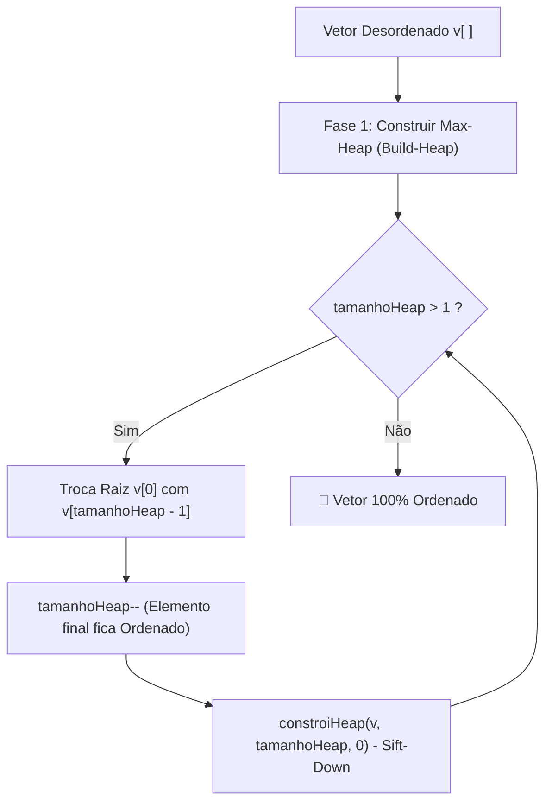

<div align="center">

# 🌲 Heapsort Algorithm & Interactive Visualizer


<p align="center">
  <strong>Implementação completa do algoritmo Heapsort em C com uma Single Page Application (SPA) moderna e didática para visualização interativa do Max-Heap e do vetor em tempo real.</strong>
</p>

[Visualizar Demonstração](#-como-executar-a-spa) • [Estrutura do Projeto](#-estrutura-do-projeto) • [Teoria e Complexidade](#-fundamentos-teóricos) • [Roteiro de Apresentação](./ROTEIRO_APRESENTACAO.md)

</div>

---

## 📌 Sobre o Projeto

Este projeto foi desenvolvido com foco acadêmico e de portfólio para demonstrar o funcionamento prático do **Heapsort**. Em vez de apresentar apenas o código estático em C, o projeto conta com uma ferramenta web interativa projetada para salas de aula, seminários e estudo individual.

### ✨ Principais Recursos da SPA

- 🌲 **Visão Dual Sincronizada**: Renderização geométrica em SVG da **Árvore Binária Quase Completa** conectada diretamente com a representação linear da memória física do **Array (`v[]`)**.
- 💻 **Código em C em Tempo Real**: Exibição lateral do arquivo `heapsortcpp.c` com a linha ativa sendo iluminada a cada micro-operação (troca, comparação ou descida na árvore).
- 🎙️ **Narrativa Didática**: Cada passo é traduzido em português claro, explicando o motivo matemático de cada troca e comparação.
- 🔊 **Efeitos Sonoros Sintetizados**: Tons harmônicos gerados nativamente via Web Audio API para comparações, trocas (*swaps*) e finalização (com botão mudo).
- 🔍 **Inspetor Interativo de Nós**: Clique em qualquer nó para inspecionar seus índices de Pai ($\lfloor (i-1)/2 \rfloor$) e Filhos ($2i+1$, $2i+2$), validando a propriedade de Max-Heap na hora.
- ⌨️ **Controles de Apresentação e Atalhos**: Suporte para avanço passo a passo, reprodução automática, ajuste de velocidade e teclas de atalho (`Espaço`, `Setas`, `Home`, `End`).
- 📊 **Métricas em Tempo Real**: Contagem contínua de comparações, trocas efetuadas e nós ativos na heap.

---

## 📁 Estrutura do Projeto

```text
heapsort/
├── heapsortcpp.c          # Implementação canônica do Heapsort em C
├── iniciar_windows.bat    # Script de 1 clique para executar no Windows
├── iniciar_mac.sh         # Script de 1 clique para executar no macOS / Linux
├── ROTEIRO_APRESENTACAO.md# Guia para apresentação com divisão de falas e FAQ
└── view/                  # Single Page Application (SPA)
    ├── index.html         # Estrutura e marcação acessível
    ├── styles.css         # Design system escuro (Dark Theme) e responsivo
    ├── heapsort.js        # Simulador e gerador de passos atômicos
    ├── app.js             # Renderizador SVG, Web Audio e controles interativos
    └── README.md          # Instruções específicas da SPA
```

---

## 🚀 Como Executar a SPA Localmente

### No Windows:
Basta dar dois cliques no arquivo:
```cmd
iniciar_windows.bat
```
Ou pelo terminal:
```cmd
cd view
python -m http.server 3000
```
Acesse no navegador: `http://localhost:3000`

---

### No macOS / Linux:
Execute no terminal:
```bash
./iniciar_mac.sh
```
Ou com Python:
```bash
cd view
python3 -m http.server 3000
```
Acesse no navegador: `http://localhost:3000`

---

## ⚙️ Como Compilar e Rodar o Código em C

Caso queira executar a implementação em C puro:

```bash
# Compilando com GCC
gcc -Wall -O2 heapsortcpp.c -o heapsort

# Executando no Linux/macOS
./heapsort

# Executando no Windows
heapsort.exe
```

---

## 🧠 Fundamentos Teóricos

O **Heapsort** é um algoritmo de ordenação por comparação baseado em um **Max-Heap**, operando em duas grandes fases:



### 1. Fórmulas de Navegação em Base 0:
- **Pai de um nó $i$:** $\lfloor (i - 1) / 2 \rfloor$
- **Filho Esquerdo de $i$:** $2i + 1$
- **Filho Direito de $i$:** $2i + 2$
- **Último nó com filhos:** $\lfloor (\text{tamanhoHeap} - 2) / 2 \rfloor$

### 2. Tabela de Complexidade Assintótica:

| Cenário | Tempo | Espaço Auxiliar | Estabilidade |
| :--- | :---: | :---: | :---: |
| **Melhor Caso** | $\mathcal{O}(n \log n)$ | $\mathcal{O}(1)$ | Não Estável |
| **Médio Caso** | $\mathcal{O}(n \log n)$ | $\mathcal{O}(1)$ | Não Estável |
| **Pior Caso** | $\mathcal{O}(n \log n)$ | $\mathcal{O}(1)$ | Não Estável |

> **Destaque:** Ao contrário do Quicksort (cujo pior caso é $\mathcal{O}(n^2)$), o Heapsort garante estritamente $\mathcal{O}(n \log n)$ para qualquer permutação de entrada sem alocar memória adicional.

---

## 📄 Licença

Este projeto é distribuído sob a licença [MIT](https://opensource.org/licenses/MIT).
